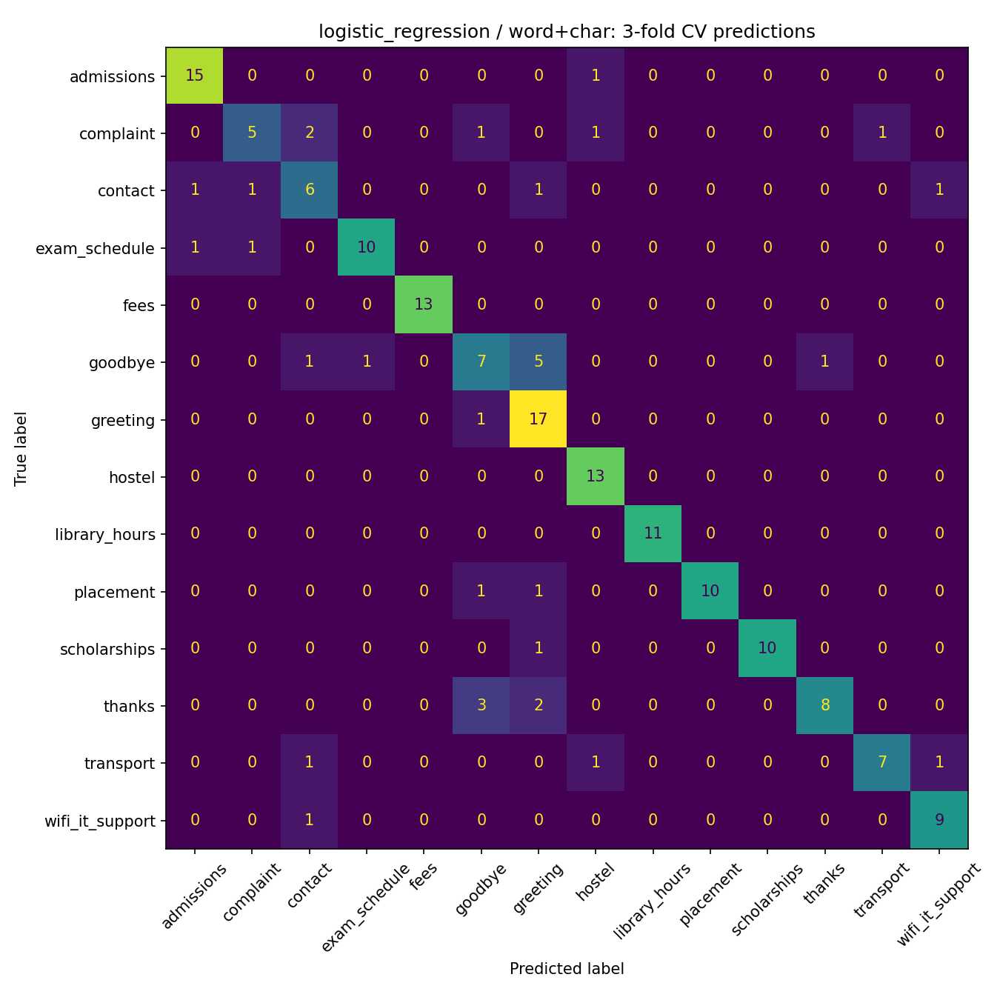

# Campus Helpdesk Chatbot

[](https://github.com/DHAIRYA027/NLP-PROJECT/actions/workflows/ci.yml)
[](LICENSE)
[](requirements.txt)

A conversational chatbot for common college questions (admissions, library hours,
exams, fees, hostel, placements, scholarships, transport, IT support, complaints),
built for an NLP course. Every component is implemented and evaluated from scratch
with classical NLP: no pretrained language model and no API calls.

It answers when it is confident, and **says so when it is not** instead of guessing:
low-confidence questions get an honest "I'm not sure", a "Did you mean…?" hint when
the model was close, the list of topics it knows, and a clearly labelled sample from
an n-gram language model.

```
You: when does the library open
Bot: The library is open Monday to Saturday, 8 AM to 9 PM. It's closed on Sundays and
     public holidays. During exam weeks it stays open until midnight.

You: libary timings on saturday
Bot: I'm not sure I can answer that. Did you mean to ask about Library hours? I can help
     with: Admissions, Library hours, Exam schedule, Fees, Hostel, Placements, ...

     Language-model sample (generated text, not an answer): "libary timings to students
     who are unable to pay the full and"

You: tell me a joke
Bot: I'm not sure I can answer that. I can help with: Admissions, Library hours, ...
```

## Quick start

```bash
git clone https://github.com/DHAIRYA027/NLP-PROJECT.git
cd NLP-PROJECT
python3 -m venv venv
source venv/bin/activate          # Windows: venv\Scripts\activate
pip install -r requirements.txt
```

The first run downloads a few small NLTK resources automatically.

```bash
streamlit run app.py              # web chat UI
python -m src.chatbot --debug     # command-line chat, shows intent and confidence
```

## How it works

```
user message
    │
    ▼
preprocessing: lowercase, tokenize, drop stopwords (keeping negations), lemmatize
    │                                                          src/preprocess.py
    ▼
features: word TF-IDF  +  character 2–5-gram TF-IDF
    │                                                          src/intent_classifier.py
    ▼
intent classifier: logistic regression (Naive Bayes and linear SVM also available)
    │
    ├── confidence ≥ threshold ──▶ answer from data/intents.json
    │
    └── confidence <  threshold ──▶ "I'm not sure…" + "Did you mean…?" + topic list
                                    + labelled trigram-LM sample       src/ngram_model.py
```

`src/chatbot.py` ties these together and returns a structured `Reply` (text, intent,
confidence, whether it fell back), which the Streamlit UI uses to show how each answer
was produced.

**NLP concepts demonstrated:** tokenization, stopword handling, lemmatization; TF-IDF
and character n-gram features; Naive Bayes, logistic regression and SVM classifiers;
confidence-based out-of-scope rejection; n-gram language modelling with add-k and
linear-interpolation smoothing; perplexity; held-out evaluation and error analysis.

## Results

Full methodology, error analysis and limitations are in **[REPORT.md](REPORT.md)**.
All numbers below come from `python -m src.evaluate` (seeded, so they reproduce
exactly) and are stored in [results/metrics.json](results/metrics.json); a test fails
if this README drifts from them.

**Intent classification** — 14 intents, 174 training patterns. CV is 5× repeated
stratified 3-fold (mean ± std over 15 folds); held-out is 42 fresh questions that are
not in the training data.

| Model | Features | CV accuracy | Held-out accuracy |
|---|---|---|---|
| Naive Bayes (original) | word | 0.740 ± 0.028 | 0.786 |
| Naive Bayes | word + char | 0.797 ± 0.029 | 0.881 |
| Logistic regression | word | 0.795 ± 0.032 | 0.833 |
| **Logistic regression (default)** | **word + char** | **0.813 ± 0.025** | **0.881** |
| Linear SVM | word | 0.785 ± 0.034 | 0.786 |
| Linear SVM | word + char | 0.806 ± 0.037 | 0.881 |

Character n-gram features are the change that matters (they handle typos and unseen
word forms); the three classifiers are within noise of each other once they have them.

**What the user actually experiences** — held-out questions, 42 valid and 26 off-topic:

| Configuration | Valid questions answered correctly | Answered wrongly | Sent to fallback | Off-topic rejected (unrelated / campus-related) |
|---|---|---|---|---|
| Original (Naive Bayes, word, threshold 0.20) | 38.1% | 0.0% | 61.9% | 95% / 83% |
| **Current (logistic regression, word + char, threshold 0.37)** | **73.8%** | 7.1% | 19.0% | 95% / 50% |

The threshold is a product decision: raising it to 0.70 gives 0% wrong answers and
rejects 83% of campus-related unsupported questions, but answers only 64% of valid
ones (see REPORT.md §5). Change it with `python -m src.chatbot --threshold 0.7`.

**Language model** — 5-fold CV perplexity on the 87-sentence corpus (lower is better;
hyperparameters tuned on a dev slice inside each fold):

| n | Add-k, k=1 | Add-k, tuned | Interpolation, hand-set weights | **Interpolation, tuned** |
|---|---|---|---|---|
| 2 | 465.3 ± 8 | 323.2 ± 19 | 344.5 ± 42 | **240.8 ± 22** |
| 3 | 552.5 ± 8 | 451.0 ± 31 | 305.7 ± 41 | **221.0 ± 26** |



## Development

```bash
pip install -r requirements-dev.txt
make test        # 130+ tests: unit, data-integrity, UI (Streamlit AppTest), reproducibility
make lint        # ruff
make eval        # regenerate results/ (about 15 seconds)
```

CI runs lint, the test suite and the evaluation on Python 3.9–3.12 for every push.

```
NLP-PROJECT/
├── app.py                      Streamlit chat UI
├── data/
│   ├── intents.json            14 intents: patterns, responses, display labels
│   ├── eval_queries.json       held-out dev/test questions (in-scope and off-topic)
│   └── corpus.txt              ~2,000-word corpus for the language model
├── src/
│   ├── preprocess.py           tokenization, stopwords, lemmatization
│   ├── intent_classifier.py    features + classifiers, self-invalidating model cache
│   ├── ngram_model.py          n-gram LM: add-k / interpolation, tuning, generation
│   ├── chatbot.py              orchestration, fallback logic, CLI
│   └── evaluate.py             full evaluation → results/
├── tests/                      pytest suite
├── results/                    metrics.json, confusion_matrix.png, threshold_curve.png
├── REPORT.md                   methodology, results, error analysis, limitations
├── Makefile, pyproject.toml    tooling (ruff, pytest)
└── .github/workflows/ci.yml
```


## License

[MIT](LICENSE)
