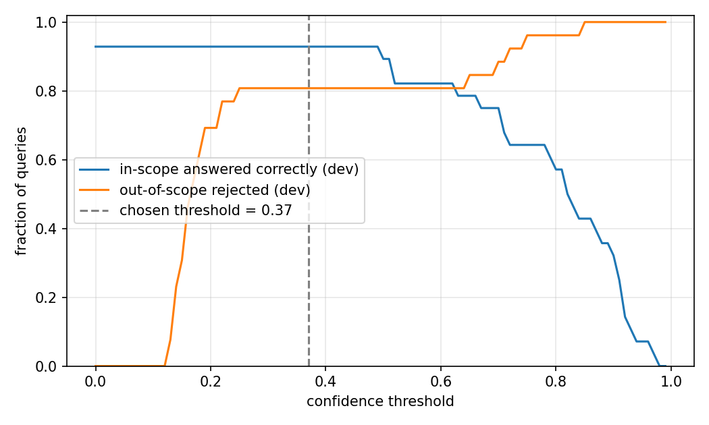

# Campus Helpdesk Chatbot — Evaluation Report

This report documents how the chatbot was built and evaluated, what the results are,
where it fails, and which claims of the first version of this report turned out to be
wrong. Every number comes from `python -m src.evaluate` (seeded; see
[results/metrics.json](results/metrics.json)). A test fails if the numbers quoted here
stop matching that file.

## 1. Summary

- **Intent accuracy.** Cross-validated accuracy rose from 0.740 (Naive Bayes on word
  TF-IDF, the original model) to 0.813 (logistic regression on word + character
  n-gram TF-IDF). On 42 fresh held-out questions it rose from 0.786 to 0.881.
- **What users experience.** The original bot answered only **38.1%** of valid held-out
  questions and sent the other 61.9% to a language-model fallback. The current bot
  answers **73.8%** correctly, gives a wrong answer to 7.1%, and sends 19.0% to an
  honest fallback.
- **The cost.** Campus-related questions the bot cannot actually answer (e.g. "are pets
  allowed in the hostel") are rejected only 50% of the time, down from 83%. This is a
  threshold trade-off; section 5 shows the whole curve.
- **Language model.** Tuned linear interpolation reaches perplexity 221.0 at n=3,
  against 552.5 for add-one smoothing.
- **Corrections.** One explanation in the first version of this report was wrong (section
  4) and one comparison was weaker than presented (section 7). Several code defects were
  found and fixed (section 8).

## 2. Data and evaluation protocol

| Data | Size | Use |
|---|---|---|
| Training patterns (`data/intents.json`) | 14 intents, 174 patterns (10–18 per intent) | training, cross-validation |
| In-scope dev questions | 28 (2 per intent) | choose the confidence threshold |
| In-scope test questions | 42 (3 per intent) | final reporting |
| Off-topic dev queries | 26 (20 unrelated, 6 campus-related) | choose the confidence threshold |
| Off-topic test queries | 26 (20 unrelated, 6 campus-related) | final reporting |
| Language-model corpus (`data/corpus.txt`) | 87 sentences, 1,954 tokens | n-gram model |

All of this data was written by hand for the project; none comes from real users, and
none of the evaluation queries appears in the training patterns (a test checks this).

**Protocol.** Model and feature comparisons use 5× repeated stratified 3-fold
cross-validation on the training patterns and report mean ± standard deviation over the
15 folds. Held-out numbers train on all patterns and score the unseen questions. The
confidence threshold is chosen on the dev queries only. Language-model numbers use 5-fold
cross-validation over corpus sentences, with every hyperparameter tuned on a dev slice of
the training portion so the test fold never influences tuning.

**Statistical power.** With 42 held-out questions one question is 2.4 points of accuracy,
and a binomial 95% interval around 0.881 is roughly ±10 points. The 15-fold standard
deviations are about 0.03. Differences smaller than that should not be read as real.

**How the evaluation evolved (disclosure).** The test split was scored several times
during development, so it is not a pristine estimate and the held-out numbers are likely
slightly optimistic. In order:

1. The first threshold was chosen from cross-validated probabilities of the training
   patterns. With the preprocessing of that moment it picked 0.72, which answered only
   57.1% of held-out questions, because patterns resemble each other more than real
   questions do. It was replaced by the separate dev set of natural questions above.
2. On that dev set, keeping question words (what, how, when…) was found to raise
   confidence on off-topic queries ("what is the capital of france" scored 0.56). It
   improved cross-validation accuracy by under a point and lowered the best dev score
   from 0.87 to 0.79, so only negations are kept. This was an exploratory comparison and
   is not part of `evaluate.py`.
3. In the final configuration the original pattern-based selection would pick 0.25 and
   would have scored better on the test set (83.3% answered correctly versus 73.8%, same
   off-topic rejection). The pre-specified dev rule was kept: switching because the test
   set prefers another value would be tuning on the test set.

## 3. Intent classification

| Model | Features | CV accuracy | CV macro-F1 | Held-out accuracy | Held-out macro-F1 |
|---|---|---|---|---|---|
| Naive Bayes (original) | word | 0.740 ± 0.028 | 0.726 ± 0.038 | 0.786 | 0.750 |
| Naive Bayes | word + char | 0.797 ± 0.029 | 0.782 ± 0.037 | 0.881 | 0.874 |
| Logistic regression | word | 0.795 ± 0.032 | 0.789 ± 0.032 | 0.833 | 0.798 |
| **Logistic regression (default)** | **word + char** | **0.813 ± 0.025** | **0.800 ± 0.030** | **0.881** | **0.876** |
| Linear SVM | word | 0.785 ± 0.034 | 0.780 ± 0.036 | 0.786 | 0.750 |
| Linear SVM | word + char | 0.806 ± 0.037 | 0.791 ± 0.039 | 0.881 | 0.874 |

**Findings.**

- **Character n-grams are the robust improvement.** Adding character 2–5-gram TF-IDF to
  the word features raises cross-validated accuracy for every classifier (+5.7 points for
  Naive Bayes, +1.8 for logistic regression, +2.1 for the SVM) and held-out accuracy by
  4.8 to 9.5 points. They give typos and unseen word forms ("libary", "timings") partial
  credit instead of an empty feature vector.
- **The choice of classifier matters much less.** With character features the three
  models differ by at most 1.6 points of CV accuracy, which is inside one standard
  deviation, and tie exactly on held-out accuracy (0.881). Logistic regression is the default
  because it has the best CV mean, not because it is demonstrably better.
- **Exploratory checks** (run during development, not part of `evaluate.py`): word
  bigrams hurt (0.776 → 0.749 for logistic regression; too sparse for 174 examples) and
  expanding contractions made no difference.

## 4. Error analysis


**Correcting the first report.** The first version said `greeting` acts as a dumping
ground because it "has the broadest, lowest-magnitude decision boundary" under TF-IDF,
and that logistic regression and the SVM "reduce" the problem. Neither claim holds up.
Counting the errors directly (3-fold CV, default model) shows the real mechanism:

| Features | Items with no known feature | Errors | Errors predicted `greeting` | …of which had no known feature |
|---|---|---|---|---|
| word | 23 | 38 | 19 | 18 |
| word + char | 0 | 33 | 10 | 0 |

When a test question shares no word with the training fold, its feature vector is all
zeros and the classifier can only answer from the class prior, which favours the largest
class, `greeting`. 18 of the 19 errors predicted as `greeting` are of that kind. This is
a vocabulary-coverage problem, not a decision-boundary one, and it is why character
n-grams help: with them no question is ever featureless, and errors predicted as
`greeting` fall from 19 to 10. (The classifier also now reports zero confidence for
input with no features at all, such as `???`, rather than guessing.)

**Remaining confusions** (3-fold CV, default model): `goodbye → greeting` ×5,
`thanks → goodbye` ×3, `thanks → greeting` ×2, `complaint → contact` ×2. The short
smalltalk intents share few distinguishing words, and "who do I talk to for a complaint"
is genuinely ambiguous between `contact` and `complaint`.

**Held-out mistakes** (5 of 42):

| Question | Expected | Predicted | Confidence | Result |
|---|---|---|---|---|
| alright, i'll leave now | goodbye | greeting | 0.17 | fallback (harmless) |
| how can i enroll in the btech program | admissions | greeting | 0.12 | fallback (harmless) |
| which companies recruit from this college | placement | contact | 0.42 | wrong answer |
| when does campus recruitment begin | placement | wifi_it_support | 0.61 | wrong answer |
| where can i park my bike on campus | transport | wifi_it_support | 0.67 | wrong answer |

The three confident mistakes point to **shortcut words**: "campus" occurs in the Wi-Fi
patterns ("connect to campus wifi") and "college" in the contact patterns. Removing the
word confirms it for two of the three: without "college" the first question is classified
as `placement` (0.23, correct but below the threshold), and without "campus" the parking
question is classified as `transport` (0.14). The third ("when does campus recruitment
begin") is not fixed by removing "campus", because "recruitment" appears in no training
pattern. The other two misses are vocabulary gaps ("enroll", "leave") that fall to the
fallback instead of producing a wrong answer.

## 5. Out-of-scope handling and the confidence threshold

A question is answered only if the classifier's top probability reaches a threshold;
otherwise the bot falls back. The threshold was chosen on the dev queries by maximising
the mean of (valid questions answered correctly) and (off-topic queries rejected),
taking the middle of the best plateau. That gives **0.37**.



Held-out results at several thresholds. Rows are reported for transparency; **the shipped
threshold was not chosen from this table.**

| Threshold | Valid answered correctly | Answered wrongly | Sent to fallback | Unrelated off-topic rejected | Campus-related off-topic rejected |
|---|---|---|---|---|---|
| original bot (0.20, Naive Bayes, word) | 38.1% | 0.0% | 61.9% | 95% | 83% |
| 0.20 | 88.1% | 7.1% | 4.8% | 90% | 33% |
| 0.30 | 78.6% | 7.1% | 14.3% | 95% | 50% |
| **0.40 (≈ shipped 0.37)** | 73.8% | 7.1% | 19.0% | 95% | 50% |
| 0.50 | 71.4% | 4.8% | 23.8% | 95% | 50% |
| 0.60 | 69.0% | 4.8% | 26.2% | 95% | 50% |
| 0.70 | 64.3% | 0.0% | 35.7% | 95% | 83% |
| 0.80 | 52.4% | 0.0% | 47.6% | 95% | 83% |

(At exactly 0.37, the shipped value, the figures are 73.8% / 7.1% / 19.0% / 95% / 50%,
identical to the 0.40 row.)

**Reading the trade-off.** Unrelated off-topic queries are rejected 95% of the time at
every threshold above 0.20, so the threshold mostly trades valid answers against
campus-related unsupported questions. If a wrong canned answer is worse than "I'm not
sure" for your deployment, use 0.70: no wrong answers on this test set, at the price of
answering 64% of valid questions. The original bot's 0.20 threshold was never tuned, and
with Naive Bayes it sent 62% of valid held-out questions to the fallback.

**What a threshold cannot fix.** Confidence is a weak off-topic detector: on the dev set
"can you recommend a good movie" scores 0.84 and is answered with "Hello!", because the
word "good" appears in the greeting patterns, while some valid questions score as low as
0.14.

## 6. Limitations and next steps

- **Data scale and provenance.** 174 patterns and 87 corpus sentences, all hand-written.
  Real user traffic would be messier. The evaluation sets are small (see section 2).
- **Campus-related questions that no intent covers** cannot be separated from covered
  ones by confidence alone (50% rejected at the default threshold). The standard remedy
  is a trained *off-topic* class built from many off-topic and "almost in-scope"
  examples; this needs more labelled data than the project has.
- **Shortcut words** ("good" → greeting, "campus" → Wi-Fi, "college" → contact) cause the
  confident mistakes above. More varied patterns that use those words in other intents
  would reduce this; it was not done because it would mean editing training data after
  inspecting the test results.
- **No dialogue state.** Every message is handled on its own; "what about Sundays?" after
  a library question is not understood.
- **Language model.** A trigram model on 1,954 tokens cannot produce meaningful text, so
  its output is only ever shown as a labelled sample (section 7).
- **Placeholder answers.** The facts in `data/intents.json` are invented and must be
  replaced before real use.

Natural next steps: sentence embeddings as features (the first thing to try against the
vocabulary-coverage problem), an explicit off-topic class, calibrated probabilities, and
multi-turn context.

## 7. Language model

5-fold cross-validated perplexity over the 87 corpus sentences (mean ± std over folds).
Add-k's `k` and the interpolation weights are tuned on a dev slice inside each fold.

| n | Add-k, k=1 | Add-k, tuned | Interpolation, hand-set weights | **Interpolation, tuned** |
|---|---|---|---|---|
| 1 | 365.9 ± 16 | 365.9 ± 16 | 365.9 ± 16 | 365.9 ± 16 |
| 2 | 465.3 ± 8 | 323.2 ± 19 | 344.5 ± 42 | **240.8 ± 22** |
| 3 | 552.5 ± 8 | 451.0 ± 31 | 305.7 ± 41 | **221.0 ± 26** |

For n=1 the four columns coincide: unigram interpolation is add-one smoothing, and the
tuner picks `k=1` in every fold.

**Findings.**

- **The first report's conclusion stands, with a correction to how it was supported.** It
  compared interpolation to add-one smoothing (`k=1`), a deliberately weak baseline, and
  its interpolation weights were set by hand. With both tuned, interpolation is still far
  better (221.0 vs 451.0 at n=3), so the conclusion is stronger than the evidence offered
  for it. The hand-set bigram weights (0.25/0.75) were actually *worse* than tuned add-k
  (344.5 vs 323.2): the weights matter.
- **Add-k gets worse as n grows** even when tuned (323.2 at n=2, 451.0 at n=3): with ~2,000
  words most trigram contexts are unseen and add-k spreads probability over the whole
  vocabulary. Interpolation backs off to the lower orders instead.
- **Trigram vs bigram interpolation is within noise** (221.0 ± 26 vs 240.8 ± 22).
- **The selected weights lean on the unigram term** (0.7/0.3 for bigrams, 0.6/0.2/0.2 for
  trigrams) because the corpus is so small. These weights are the grid point with the
  lowest mean held-out perplexity over the five folds and are the defaults in
  `src/ngram_model.py`; a test checks that they still match.
- **Perplexity-optimal is not generation-optimal.** Sampling uses the top 8 words at each
  step, never repeats a word immediately, and is discarded if shorter than six words.
  The text is still only locally plausible, which is why it is labelled "generated text,
  not an answer".

## 8. What changed since the first version

| Change | Why | Evidence |
|---|---|---|
| Chatbot now uses logistic regression and interpolation smoothing | It shipped Naive Bayes and add-one, the two *worse* options in its own report | sections 3 and 7 |
| Added character n-gram features | Questions with unseen words had no features (section 4) | CV +1.8 to +5.7 points |
| Keep negations in preprocessing; keep question words out | Negation changes meaning; question words raised off-topic confidence | section 2, point 2 |
| Confidence threshold 0.20 → 0.37, chosen on a dev set | The old value, with Naive Bayes, declined 62% of valid questions | section 5 |
| Honest fallback with "Did you mean…?", topic list and a labelled LM sample | The old fallback presented random word sequences as "something related" | section 5 |
| Zero confidence for input with no features | A featureless input would otherwise be classified from the class prior alone | tests |
| Interpolation weights and add-k tuned by cross-validation, and validated | Hand-set weights; a zero unigram weight crashed the model with `log2(0)` | section 7, tests |
| Model cache invalidates itself | Editing `intents.json` silently kept serving the old model | tests |
| NLTK resource check fixed | `wordnet`/`omw-1.4` are zip-only, so every start tried to re-download them (about 38 s per package on the slow network where this was found; the test suite took 90 s instead of 15 s) | tests |
| Generation made reproducible (seedable, sorted vocabulary, top-k, no repeats) | Output differed between runs and processes | tests |
| Held-out dev/test queries, repeated CV with std, error analysis | Single-seed CV on the training patterns cannot show real-world behaviour | section 2 |
| Linting, 130+ tests, UI tests, CI on Python 3.9–3.12, reproducibility test | Professional hygiene; docs and metrics must stay in sync | CI |

## 9. Reproducing

```bash
pip install -r requirements-dev.txt
python -m src.evaluate     # about 15 s; rewrites results/metrics.json and the two PNGs
pytest                     # includes a test that results/metrics.json reproduces
```

Everything is seeded (cross-validation splits, language-model folds, sampling), so a
rerun gives the same numbers; the reproducibility test allows only floating-point-level
differences between platforms.
